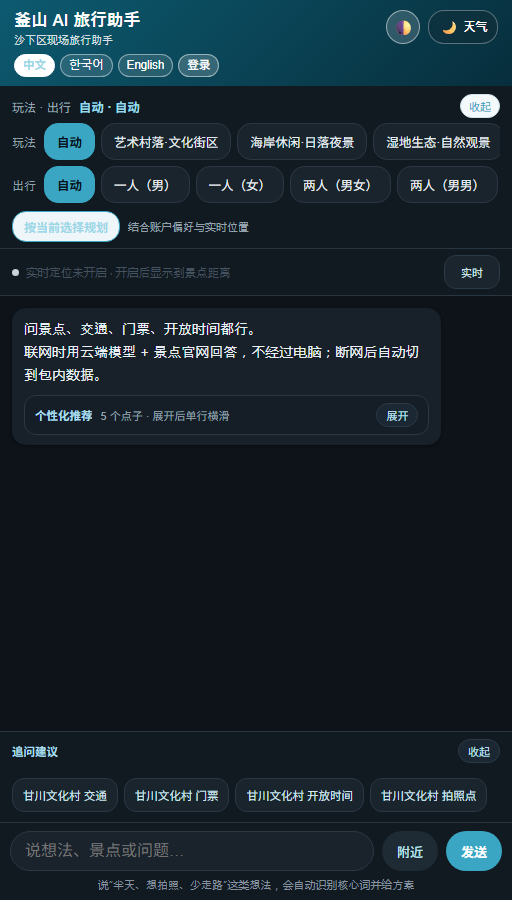
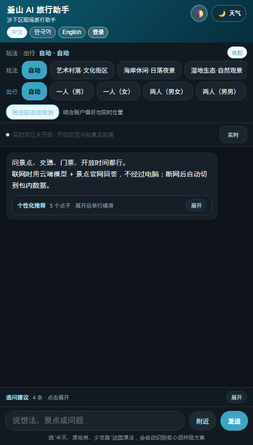
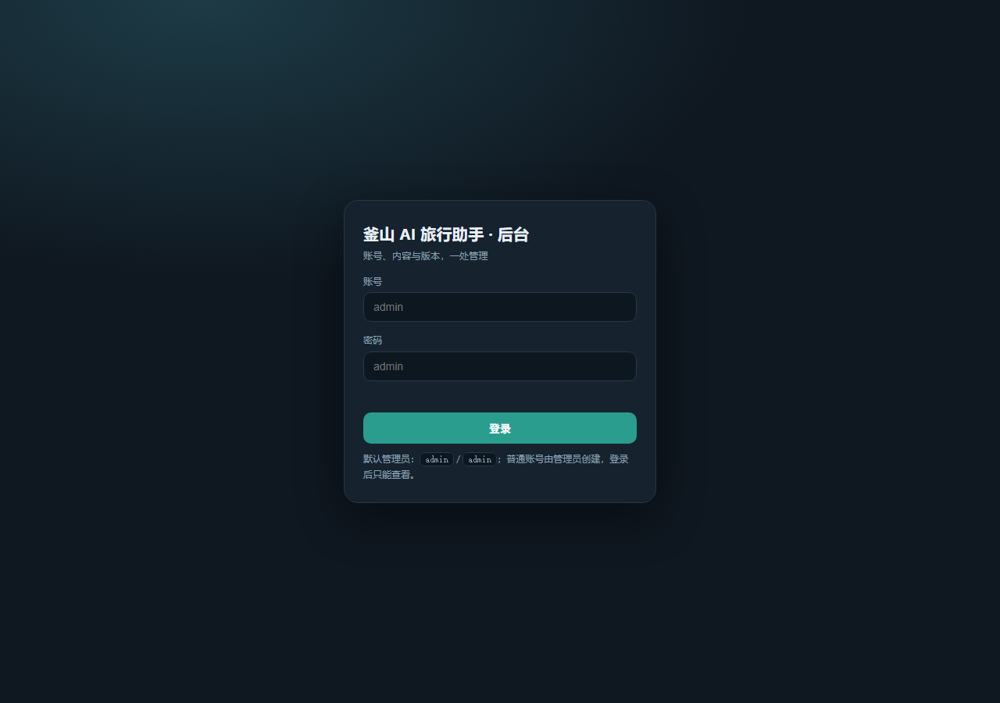
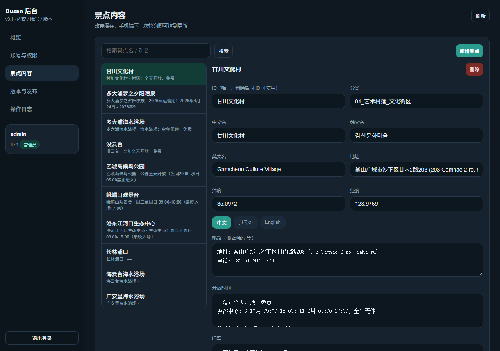

# 釜山 AI 旅行助手 v3.1 · 追问区折叠 + 后台管理 + 内容/版本实时下发

- 日期：2026-11-22
- 版本：`versionCode 24` / `versionName 3.1`（上一版 23 / 3.0）
- 产物：`Busan/dist/Busan旅行助手.apk`（10,635,569 B，10,386.3 KB）
- 仓库：<https://github.com/luohaisheng814/AI_Project_2026_2>
- 线上：<https://luohaisheng814.github.io/AI_Project_2026_2/>




---

## 一、这轮改了什么

### 1. 追问建议区「收起 / 展开」

改的是截图红圈那一块：四枚追问胶囊（甘川文化村 交通/门票/开放时间/拍照点）+ 其下输入栏的上面一条。

- `#followups` 从「一排胶囊」改成「头部 + 主体」两段：
  - 头部固定一行：`追问建议` + 条数（折叠时显示 `4 条 · 点击展开`）+ 右侧 `收起 / 展开` 胶囊按钮；
  - 主体才是原来的胶囊列表，保留 27vh 限高与横向自动换行。
- 折叠时主体 `display:none`，整块只剩 36px 高的一行，原来追问条占的三行空间直接让给聊天区。
- 状态写 `localStorage.busan_fu_collapsed`（`'1'` 折叠 / `'0'` 展开），重开 App 保持上次选择。
- 三语文案随语言按钮切换：`追问建议 / 이어서 묻기 / Follow-ups`、`收起 / 접기 / Collapse`、`展开 / 펼치기 / Expand`。
- 夜间模式单独配色：标题亮蓝、动作胶囊深底、胶囊深底亮字，不出现白块。
- 无追问时整块隐藏（`hidden`），不会留一条空头部。

### 2. 后台管理软件（账号 / 权限 / 内容 / 版本）

新增三层，全部标准库实现，不引第三方依赖：

| 文件 | 作用 |
| --- | --- |
| `Busan/admin_store.py` | 数据层：`spots`、`app_settings`、`app_versions`、`admin_audit` 四张表；`users` 补 `nickname/email/status`；账号与景点 CRUD；内容 `rev` 自增；版本发布；静态发布包 |
| `Busan/admin_server.py` | `ThreadingHTTPServer`：`/admin` 管理台 + `/api/*` JSON 接口 + `/api/download` 下发 APK + Bearer token 会话（12h） |
| `Busan/admin_ui.html` | 单页管理台：登录页 + 概览 / 账号与权限 / 景点内容 / 版本与发布 / 操作日志 五个标签 |




**账号与权限**

- 默认管理员：`admin` / `admin`（沿用 `db_config` 的 PBKDF2 加盐哈希，`config.DEFAULT_ADMIN` 可环境变量覆盖）。
- 两级角色：
  - `admin`：可增删改账号、增删改景点、发布版本、生成静态包、看审计；
  - `user`：只读，能看账号列表（脱敏字段）、景点内容、版本历史，写入接口一律 `403`，页面顶部显示「只读」提示。
- 保护规则：不能删除当前登录账号；至少保留一个管理员；普通账号可停用（`status=disabled` 后无法登录后台）。
- 每个写操作落 `admin_audit`：`user.create / user.update / user.delete / spot.save / spot.delete / version.publish / static.publish / login`。

**内容管理（前端数据库）**

- 景点字段与 `data.json` 对齐：`id / name / name_ko / name_en / category / address / lat / lng / fields{zh,ko,en}{overview,hours,ticket,highlights,course,tips,transport,source} / aliases`。
- 后台可搜索、新增、修改、软删除（`deleted=1`，前端立即不再下发；同 id 再新增即恢复）。
- 每次保存 `content_rev + 1`；`/api/content` 只下发 `deleted=0` 的条目，手机端按 rev 判断新旧。

**版本管理**

- 发布新版本时记录 `version_name / version_code / notes / apk_size / apk_sha256 / created_at`，并把旧版本 `is_current=0`。
- 发布后自动 `publish_static()`：写 `android/assets/api/state.json`、`content.json`，随 GitHub Pages 一起发布，作为手机端没有局域网后台时的兜底。

启动方式：

```bash
D:\AI_Project_2026_2\.venv\Scripts\python.exe Busan\admin_server.py
# 浏览器打开 http://127.0.0.1:8765/admin
# 手机同一 Wi‑Fi 打开 http://<电脑局域网IP>:8765/admin
```

### 3. 前端实时同步与新版本提示

新增 `Busan/android/assets/sync.js`（约 300 行，无依赖）：

1. **启动先吃缓存**：把上次拉到的内容（`localStorage.busan_admin_content`）合并进 `BUSAN_DATA.spots` 与 `BusanCloud.getDb().spots`，断网也保持最新内容。
2. **轮询**：每 25 秒 + 回到前台 + 网络恢复时请求 `GET /api/state`；地址顺序：
   - 设置里手填 `busan_admin_base` →
   - 构建注入 `assets/admin_base.js` 的 `window.BUSAN_ADMIN_BASE` →
   - Pages 兜底 `https://luohaisheng814.github.io/AI_Project_2026_2/api/state.json`。
3. **内容变了**：服务端 `rev` 大于本地记录 → 底部弹横幅「后台内容已更新（rev N）· 刷新」；点刷新拉 `/api/content`、写缓存、合并进内存库、`location.reload()` 让已显示的气泡也换成新内容。
4. **版本变了**：`state.version.code > 24` → 弹更新层：版本名、更新说明、「下载安装包 / 稍后 / 跳过这个版本」；下载优先本地 `/api/download`，兜底 GitHub raw。
5. **设置面板**：账户面板新增「内容与版本」一节，可填后台地址、保存并检查、立即检查，并显示「已连接 · rev N」或「未连接后台，使用包内离线数据」。

配套改动：

- `index.html` 注入 `window.BUSAN_BUILD = { code: 24, name: "3.1" }`，按顺序加载 `admin_base.js`、`sync.js`；
- `sw.js` 缓存名升 `busan-3.1`，缓存清单加两个新文件，`/api/` 请求改「只走网络」，避免 PWA 拿到过期 rev；
- Android 壳 `MainActivity` 类注释与 UA 升 `BusanTour/3.1`；manifest 加 v3.1 说明块；
- iOS `project.yml` 3.1 / 24、README 与 PWA 构建说明同步 3.1。

### 4. 顺手修掉的两个问题

- `/api/state`、`/api/content` 增加 `.json` 别名：手机端和 Pages 静态包可以用同一套路径，少一次 404 往返。
- 软删除景点同 id 再新增：原来报「id 已存在」，现在按「恢复 + 覆盖」处理，和后台文案「删除后同 ID 可复用」一致。

---

## 二、验证与可复跑证据

| 项目 | 命令 | 结果 |
| --- | --- | --- |
| 后台接口 | `.venv\Scripts\python.exe Busan\admin_tests.py` | **43 通过 / 0 失败** |
| v3.1 前端断言 | `node Busan\apk_build\test_v31.js` | **81 通过 / 0 失败** |
| v3.0 回归 | `node Busan\apk_build\test_v30.js` | 59 / 0 |
| v2.9 回归 | `test_v29.js` | 71 / 0 |
| v2.8 回归 | `test_v28.js` | 103 / 0 |
| v2.7 回归 | `test_v27.js` | 50 / 0 |
| v2.6 回归 | `test_v26.js` | 74 / 0 |
| v2.5 回归 | `test_v25.js` | 63 / 0 |
| v2.3 回归 | `test_v23.js` | 50 / 0 |
| v2.2 回归 | `test_v22.js` | 43 / 0 |
| 离线引擎 | `test_engine.js` | 全部断言通过 |

合计 **637 条断言 0 失败**（不含引擎脚本内部的逐条断言）。

后台测试覆盖：公开接口 / CORS / `.json` 别名 / 错误密码 401 / `admin admin` 登录 / 无令牌 401 / Bearer 取当前账号 / 建号 / 重名拒绝 / 改昵称邮箱 / 新号可登录 / 普通用户可读 / 普通用户写 403 / 看不到审计 / 景点新增 / 修改 / 删除 / rev 逐次 +1 / 前端 `/api/content` 同步可见 / 删除后不再下发 / 软删除可按 id 取回 / 同 id 恢复 / 版本非法被拒 / 下载 APK / 静态包落盘且 rev 一致 / 管理员保护 / 测试数据清理。

**真实浏览器联调**（无头 Chrome 打开后台、自动 `admin/admin` 登录、点「景点内容」、点第一个景点）：

```
[22:54:50] "GET /api/stats" 200
[22:54:50] "GET /api/spots" 200
[22:54:50] "GET /api/spots/%E7%94%98%E5%B7%9D%E6%96%87%E5%8C%96%E6%9D%91" 200
```

截图见 `img_v31/admin_content.png`：18 个景点、甘川文化村三语字段、`管理员` 徽标、`删除` 按钮均正常。

**构建与签名**

| 项 | 值 |
| --- | --- |
| `aapt2 dump badging` | `package='com.busan.tour' versionCode='24' versionName='3.1'` |
| APK 体积 | 10,635,569 B（10,386.3 KB），较 v3.0 的 10,602,539 B +33,030 B |
| SHA-256 | `12b3bd710d5ceec0d26adc860f83854f88584637435a0bd7d8e93589fb7f55d8` |
| 签名 | `apksigner verify` 通过，证书 SHA-256 `9d91ed6b8ffeec5eaf5b597ee19f56bfda6f8663d94ec726390a552224d33356` |
| 包内新资源 | `assets/sync.js`、`assets/admin_base.js`、`assets/api/state.json`、`assets/api/content.json` 均在 |

**静态发布包**

- `assets/api/state.json`：`rev=17`，`version=3.1/24`，`size=10635569`，`sha256=12b3bd…`
- `assets/api/content.json`：18 个景点、三语 fields 完整。

---

## 三、还能再加什么（按性价比排序）

### A. 内容运营（最该先做，都是后台加字段就能上）

1. **图片上传与替换**：现在景点图是仓库内固定命名的 Wikimedia 图片。后台加「上传图片 → 存 `assets/photos/<spot>/` → content 带文件列表」，才真正能换封面、补新景点图。
2. **富文本/多段攻略**：`fields` 现在是一段纯文本。可拆成「段落 + 小标题 + 要点列表」，前端按块渲染；后台用可增删的段落编辑器。
3. **草稿与预览**：改动先存草稿，管理台内点「预览手机效果」，确认后再发布会 +rev，避免误改直接推给游客。
4. **定时发布 / 上下架**：景点加 `publish_at / offline_at`，樱花季、活动摊位这类内容按时自动上/下，不用人守着。
5. **多城市扩展**：`spots` 加 `city_id`，`app_settings` 存城市配置，同一套后台管釜山、庆州、首尔；前端按定位切城市包。

### B. 交互与产品

6. **追问区再加「常用四问」固定位**：现在追问完全跟回答走；可留一枚「交通/门票/时间/拍照」固定胶囊，折叠时也能一键问。
7. **行程收藏与导出**：把 AI 给的一日路线存成本地行程卡，支持拖动排序、导出 `.ics` 日历或图片分享。
8. **离线地图包**：现在地图是跳 NAVER/Google 外链。可内置沙下区离线瓦片（或简版示意图 + 步行连线），断网也能看「自己在哪、下一站怎么走」。
9. **语音输入/朗读**：WebView 的 `SpeechRecognition` 在安卓可用，走路时问一句比打字现实；回答可加「朗读」按钮（TTS）。
10. **多语言再扩**：现在中/韩/英，赴釜山游客里日语占比不低，加 `ja` 只需补 `fields.ja` 与 UI 文案。

### C. 数据与智能

11. **问答日志回流后台**：`query_logs` 已有表，但只在桌面后台看。搬到 Web 后台做「高频问题 / 无命中问题」榜单，直接指导补景点、补别名。
12. **别名与错字自动学习**：把无命中的 query 聚类，后台一键「设为某景点别名」，减少「看川/甘村」这类靠手写别名的维护成本。
13. **推荐理由可解释化**：结论卡已有「时间/天气/距离」三胶囊，可再加「为什么不是另一个」，提升信任度。
14. **内容质量校验**：发布前跑一遍「必填字段缺失 / 坐标落在海里 / 电话格式 / 三语缺项」检查，后台红黄灯提示。

### D. 运维与安全（现在最薄的一块）

15. **后台账号安全**：加登录失败限速、会话持久化（现在 token 在内存，重启服务即全部失效）、操作二次确认（删除/发布）。
16. **HTTPS / 反向代理**：目前是局域网 HTTP。要给外部用户用，需 Nginx + 证书，或直接把后台只绑 `127.0.0.1` 用 SSH 隧道。
17. **自动打包流水线**：后台点「发布版本」时自动跑 `build_apk.py`、算 SHA、传 GitHub Release；现在还要人工构建后填库。
18. **增量内容包**：`content.json` 已很小（约 100 KB），可再做 gzip/差量，弱网下更快；APK 更新也可只下发变更的 assets（WebView 支持从 `files` 目录热替换）。
19. **崩溃与埋点**：WebView 错误、接口失败、定位失败上报到本地日志，后台「诊断」页看最近 50 条。

### E. 商业化（有真实流量再说）

20. 店铺/餐厅合作位（后台加 `partner` 标记与结算字段）、行程打包卖、离线包内购。当前阶段不建议先做，会拖慢内容与体验。

**建议下一轮就做 1 + 11 + 15**：图片上传让后台真正能运营，问答日志回流让内容有的放矢，登录限速与会话持久化把后台从「能跑」做到「敢放」。

---

## 四、限制与已知风险

- 后台是**局域网服务**：手机不在同一 Wi‑Fi 时只能读 Pages 静态包（内容更新要等下一次 `git push`），版本提示仍可用（state.json 里有版本）。
- 后台 **HTTP 明文**，仅适合内网/演示；对外必须加 HTTPS 与鉴权加固。
- 会话 token 存服务进程内存，**重启后台需重新登录**（管理台会自动跳回登录页，不会白屏）。
- 图片、问答提示词、多城市暂未纳入后台（列在扩展项 1/5）。
- APK 更新是「提示 + 下载」，**仍需用户手动安装**（未做静默自更新，安卓侧要 `REQUEST_INSTALL_PACKAGES` 与商店/企业分发才有更好体验）。
- `assets/api/*` 会打进 APK，但 App 运行时不读包内这份（只读网络/本地缓存），保留是为了 Pages 同源发布方便。

---

## 五、提交记录与线上实测

- `cc4595c` `feat(mobile): v3.1 追问区收起/展开 + 后台管理（账号/内容/版本）+ 内容实时下发`
- `67365fe` `docs: v3.1 日志（含可扩展功能分析）与后台/折叠态截图`
- 已推送 `origin/main`（`f7502cf..67365fe`）。

Pages 实测（2026-11-22 23:0x，带随机查询串避开缓存）：

| URL | 结果 |
| --- | --- |
| `/api/state.json` | 200，`rev=17`，`version=3.1 / code 24`，`size=10635569` |
| `/api/content.json` | 200，18 个景点，`rev=17` |
| `/admin_base.js` | 200，30 B（默认空串，不固化内网 IP） |
| `/sync.js` | 200，14,962 B |
| `/index.html` | 200，142,487 B |
| `raw/main/Busan/dist/Busan旅行助手.apk` | 200，`Content-Length=10635569`，下载后 SHA-256 与本地产物一致（`12b3bd…55d8`） |

